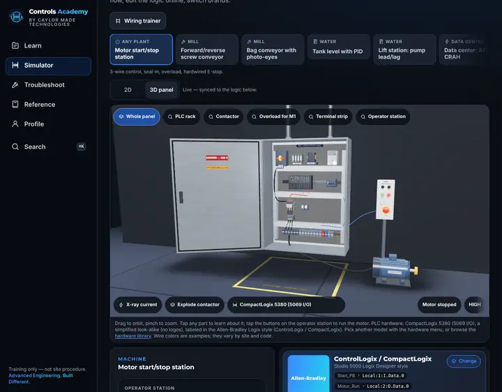
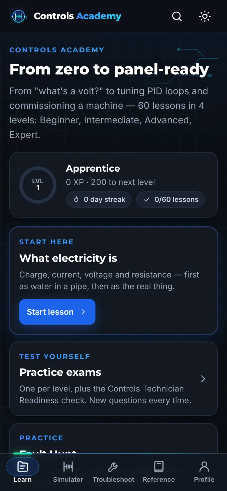
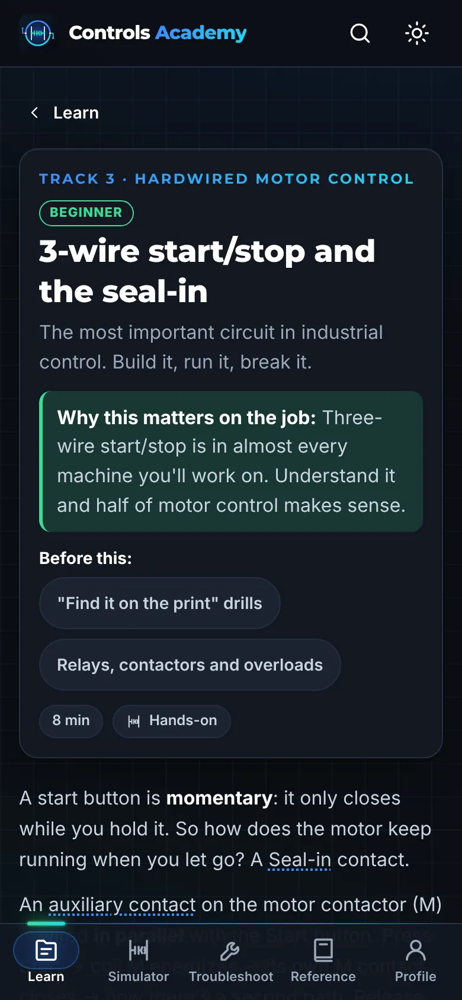
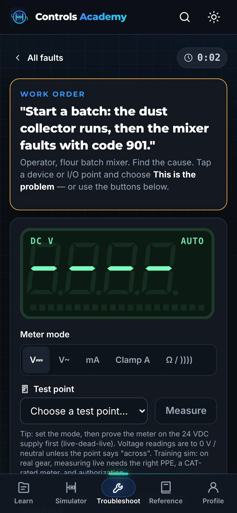
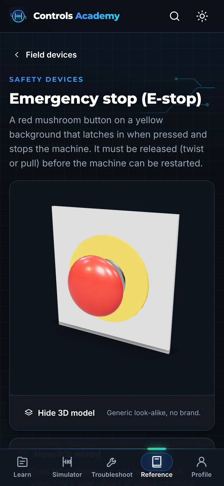
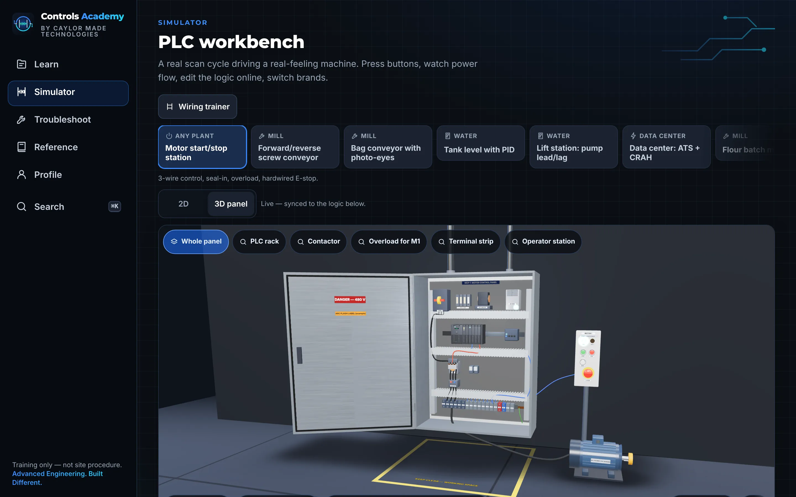

# Controls Academy

**Learn PLCs and industrial controls from zero: free, offline, hands-on.**
Built by [Caylor Made Technologies](https://caylor-made-technologies.pages.dev), Hereford, TX. *Advanced Engineering. Built Different.*

Live: https://caylor-made-technologies.github.io/controls-academy/ · Sister app: [Critical Facilities Simulator](https://caylor-made-technologies.github.io/critical-facilities-sim/)

<p></p>
<p>
  
  
  
  
</p>
<p></p>

## What it is
A phone-first, installable training app that takes someone who has never touched controls to reading prints, writing and troubleshooting ladder logic, and going online without fear.

- **Course:** 60 lessons in 12 tracks and 4 levels (Beginner → Expert), from "what is a volt" through safety, prints, hardwired motor control, PLC fundamentals, ladder logic, going online, troubleshooting, networks, drives, HMIs, building automation, PID and commissioning. Every lesson has a figure or hands-on task and a short check; a skill map, practice exams (192 questions), a readiness assessment, spaced review and printable study summaries.
- **A real PLC engine:** read inputs → solve rungs → write outputs, with a single-step scan pointer, slow-mo, prescan, forces and faults. Timers, counters, compare, math, scaling, JSR, MCR and PID. 97.7 % line coverage, enforced in the gate.
- **Ladder editor:** touch-first and keyboard friendly, undo/redo, branches, Verify (duplicate coils, missing seal-in, zero presets…), cross-reference, share links, import/export.
- **Ten brand dialects, clearly labeled:** the same logic in Allen-Bradley Logix, SLC 500 and Micro800, Siemens TIA and S7 classic, Modicon, Mitsubishi, AutomationDirect, Omron and IEC addressing.
- **Eight machines to control, in 3D:** motor start/stop station, forward/reverse screw conveyor, bag conveyor with photo-eyes, tank level with PID, lift station lead/lag, data-center transfer switch and cooling, flour batch mixer, fan on a VFD. Real motor physics: torque–speed curve, inrush, a jam that stalls the motor, a thermal overload that has to cool before it resets.
- **Fault Hunt:** 37 injected faults across the machines. Find them with a meter (live-dead-live), the I/O LEDs and the logic; scored on speed *and* safety.
- **Wiring trainer:** wire circuits terminal by terminal; the checker powers them and explains the first thing that goes wrong.
- **Reference:** 25 brand field guides, brands side by side, 19 field devices in 3D (how each is wired, fails and is tested safely), 7 troubleshooting flowcharts, 6 printable cheat sheets, a day-one-at-a-new-plant checklist, a 3D hardware library (87 models from 25 brands, simplified look-alikes, no logos), an instruction reference, a glossary and the safety rules.
- XP, streaks, badges, practice records, export/import progress. No accounts, no tracking, no cookies; everything stays on the device and works offline.

## Who it's for
New maintenance and controls techs, building-automation and data-center techs, apprentices, and anyone curious how machines think.

## Quality
- **Speed and accessibility:** Lighthouse mobile on the live site, all 41 sample pages: performance 97–100, accessibility, best practices and SEO 100, largest paint 1.2–2.33 s, no layout shift.
- **Tests:** 519 unit tests (engine, skins, content, editor, progress, 3D framing) and 140 browser checks that use every feature, plus every page at phone and desktop size in both themes (axe accessibility, console errors, sideways scroll at 320 px and up), 3D budgets, offline and damaged saved data. The same browser suites run against the live site after each deploy.
- Bugs found and how each is guarded: [docs/BUGS.md](docs/BUGS.md). Release notes: [docs/CHANGELOG.md](docs/CHANGELOG.md).

## Run it
```bash
npm ci
npm run dev        # local dev server
npm test           # unit tests
npm run coverage   # engine coverage (fails under 95 % lines / 90 % branches)
npm run verify     # the whole gate: unit + coverage, lint, typecheck, build, size budget, every browser suite
npm run verify:live            # the browser suites against the live site
npm run lighthouse             # Lighthouse on the routes in src/routes.json (set SITE_URL for live)
npm run shots                  # screenshots of every route
node scripts/readme-media.mjs  # these README images (needs a served build: node scripts/serve.mjs 4180)
```
Push to `main` deploys to GitHub Pages through GitHub Actions (Settings → Pages → Source: **GitHub Actions**).

## Contributing content
Lessons are typed data in `src/content/`. See [docs/CONTENT_GUIDE.md](docs/CONTENT_GUIDE.md). Anything vendor-specific that isn't confirmed gets a `// VERIFY` marker and a line in [docs/VERIFY.md](docs/VERIFY.md).

## Safety disclaimer
Training only. Not a substitute for qualified training, manufacturer documentation, or your site's procedures. Never apply anything here to live equipment without authorization. Practice records are not a qualification or license.

## Trademarks
Not affiliated with or endorsed by Rockwell Automation, Siemens, Schneider Electric, Mitsubishi Electric, AutomationDirect, Omron, Emerson, Beckhoff, or any other manufacturer. All trademarks belong to their owners. Brand names are used only descriptively; all UI and artwork are original.

## License
Code: MIT. Brand assets (CM monogram, app icon) © Caylor Made Technologies.
