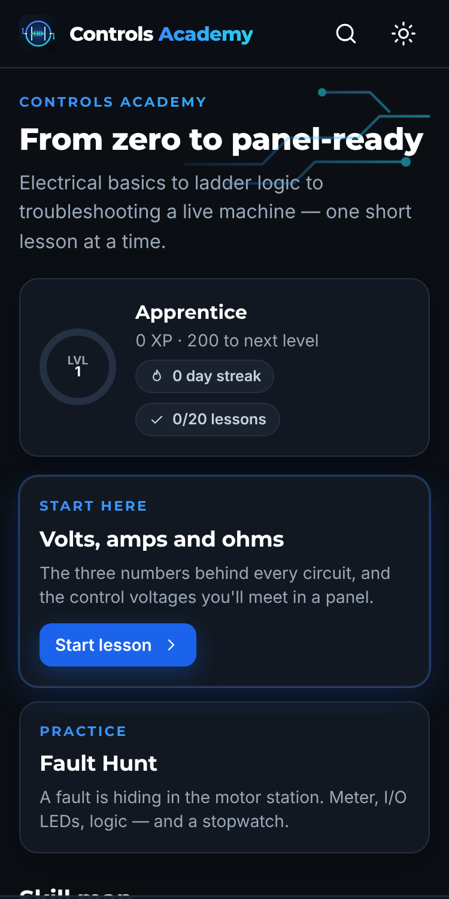
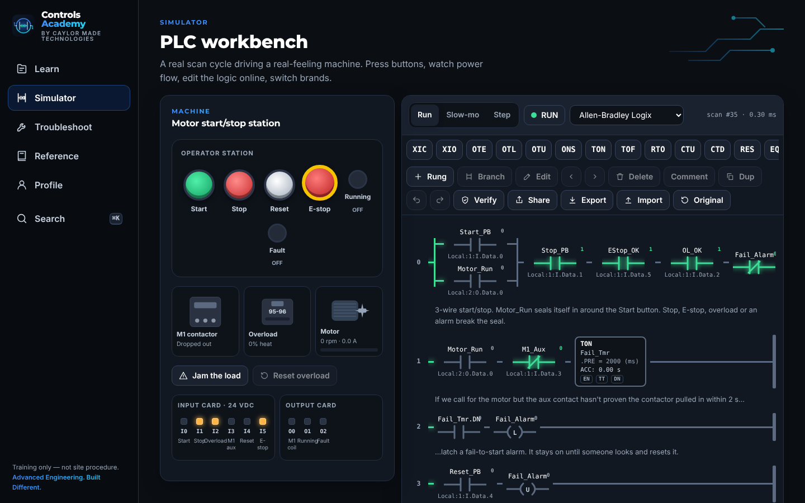
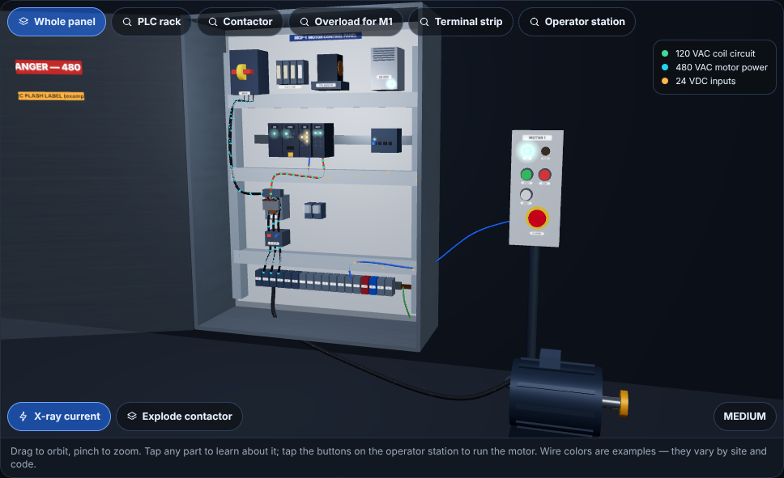

# Controls Academy

**Learn PLCs and industrial controls from zero — free, offline, hands-on.**
Built by [Caylor Made Technologies](https://caylor-made-technologies.pages.dev), Hereford, TX. *Advanced Engineering. Built Different.*

Live: https://caylor-made-technologies.github.io/controls-sim/ · Sister app: [Critical Facilities Simulator](https://caylor-made-technologies.github.io/critical-facilities-sim/)

<p>
  
  
</p>
<p></p>

## What it is
A phone-first, installable training app that takes someone who has never touched controls and walks them to reading prints, writing and troubleshooting ladder logic, and going online without fear.

- **A real PLC engine** — read inputs → solve rungs → write outputs → housekeeping, with single-step scan pointer, slow-mo, prescan, forces and faults. Timers, counters, compare, math, scaling, JSR, MCR and PID, all unit-tested.
- **Ladder editor** — touch-first, keyboard friendly, undo/redo, branches, Verify (duplicate coils, missing seal-in, zero presets…), cross-reference, share links.
- **Ten brand dialects** — the same logic shown with Allen-Bradley Logix, SLC 500, Micro800, Siemens TIA and S7 classic, Modicon, Mitsubishi (octal!), AutomationDirect, Omron and IEC conventions.
- **3D control panel** — a live, explorable enclosure: PLC LEDs follow the I/O, the contactor pulls in, the overload flag pops, X-ray shows current flowing, camera tours fly you to each part, exploded contactor. Lazy-loaded with a 2D fallback.
- **A machine to control** — motor start/stop station with hardwired E-stop, overload, aux-contact proof and pilot lights.
- **Course** — 20 lessons so far across electrical safety, prints, hardwired control, PLC fundamentals, ladder logic, going online, troubleshooting and Modbus, with interactive figures, hands-on tasks and quizzes.
- **Fault Hunt** — find injected faults with a meter (live-dead-live), I/O LEDs and the logic, scored on speed *and* safety.
- **Reference** — brand field guides, instruction reference, glossary, safety rules.
- XP, streaks, badges, certificates, spaced review, export/import progress. No accounts, no tracking.

## Who it's for
New maintenance and controls techs, building-automation and data-center techs, apprentices, and anyone curious how machines think.

## Run it
```bash
npm ci
npm run dev          # local dev server
npm test             # unit tests (engine, skins, content, editor, progress)
npm run build && npm run e2e   # browser gate: console errors, axe, overflow, screenshots
npx vite preview --port 4180 & node tests/e2e/flows.mjs && node tests/e2e/three.mjs   # interaction + 3D gates
```
Push to `main` deploys to GitHub Pages (Settings → Pages → Source: **GitHub Actions**).

## Contributing content
Lessons are typed data in `src/content/`. See [docs/CONTENT_GUIDE.md](docs/CONTENT_GUIDE.md). Anything vendor-specific you're not sure of gets a `// VERIFY` marker and a line in [docs/VERIFY.md](docs/VERIFY.md).

## Safety disclaimer
Training only. Not a substitute for qualified training, manufacturer documentation, or your site's procedures. Never apply anything here to live equipment without authorization.

## Trademarks
Not affiliated with or endorsed by Rockwell Automation, Siemens, Schneider Electric, Mitsubishi Electric, AutomationDirect, Omron, Emerson, Beckhoff, or any other manufacturer. All trademarks belong to their owners. Brand names are used only descriptively; all UI and artwork are original.

## License
Code: MIT. Brand assets (CM monogram, app icon) © Caylor Made Technologies.
